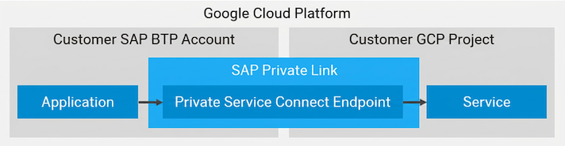

<!-- loio2efdc6ff3c104643ba3281901d367bf8 -->

# Consume Google Cloud Services in SAP BTP

SAP Private Link service establishes a private connection between selected SAP BTP services and selected services in your own Google Cloud Platform projects.

## Overview

To privately access a service in your Google project, SAP Private Link service creates a private endpoint and reuses the private link functionality of Google:

## Prerequisites

-   See [Initial Setup](../initial-setup-f2dce1d.md).
-   You have created a Google Cloud service in the Google Cloud console.

## Supported Services

The following Google Cloud services can currently be consumed from SAP BTP:

-   [Google Private Service Connect \(generic LB scenario for VMs and others\)](google-private-service-connect-generic-lb-scenario-for-vms-and-others-1ae9053.md)

> ### Note:  
> If you would like to use a service or scenario with SAP Private Link service that isn't available yet, open a support ticket on BC-CP-PRIVATELINK.

-   **[Google Private Service Connect \(generic LB scenario for VMs and others\)](google-private-service-connect-generic-lb-scenario-for-vms-and-others-1ae9053.md "Consume Google Private Service Connect with  SAP Private Link service . ")**  
Consume Google Private Service Connect with SAP Private Link service.

